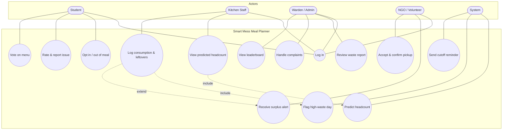
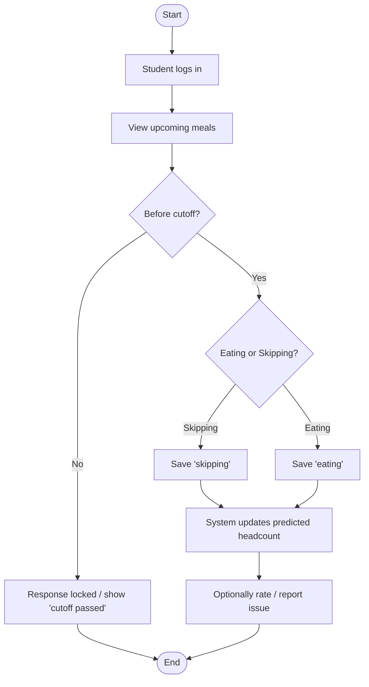
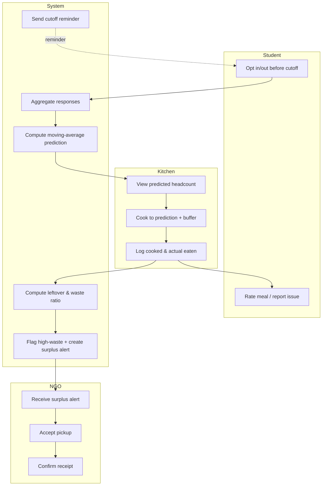
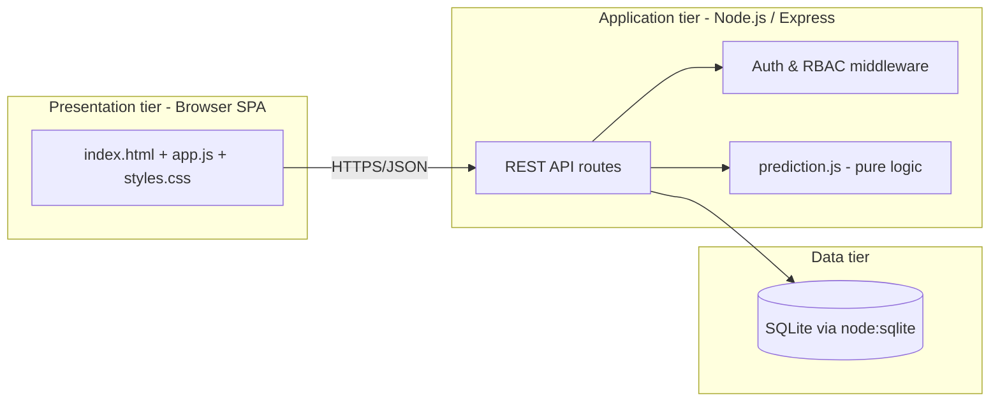

# M2 — Requirements Elicitation, Analysis & Design

**Project:** Smart Mess Meal Planner

Contents: stakeholder interviews · functional & non-functional requirements · SRS · use-case diagram · activity diagram · swim-lane diagram · architecture & component design · UI mockups · CASE-tool note.

All diagrams are written in **Mermaid**, which renders directly on GitHub and in most Markdown/CASE tools (e.g. draw.io, Visual Paradigm import). A note on reproducing them in a dedicated CASE tool is at the end.

---

## 1. Requirements elicitation — interviews

We interviewed **7 stakeholders**: 5 students, the mess manager, and a warden. Below are condensed notes and the requirement each insight produced.

### 1.1 Student interviews (5)

| # | Student (block) | Key quotes / needs | Requirement produced |
| --- | --- | --- | --- |
| S1 | Asha (A), vegetarian | "Half the time I'm not even in the hostel for dinner but they still cook for me." | Advance opt-out per meal |
| S2 | Rahul (A) | "I decide late. I need to change my answer until just before the meal." | Editable response up to a **cutoff**, then locked |
| S3 | Meera (B), vegan | "There's rarely a vegan option and no one asks." | Special-diet tag + menu vote |
| S4 | Sam (B) | "When food is bad there's nowhere to complain — you just grumble." | Rating + quality-issue reporting |
| S5 | Priya (C), gluten-free | "I'd love to know what's on the menu before I decide." | Show menu with each meal |

Common themes: **control over their own meals**, a **voice** on quality/menu, and **transparency**.

### 1.2 Mess manager interview

- "I cook by gut feeling. Some days 40 plates are wasted, some days we run out by the time the last batch arrives."
- "If I had a number to cook to, even a rough one, I'd trust it."
- "I already know roughly how many came last week — I just don't have it written down."
- Needs: **predicted headcount**, a place to **record what was actually cooked and eaten**, and **leftover tracking**.

### 1.3 Warden interview

- "I only hear about waste when it's a scandal. I want to see the trend."
- "If there's extra food, it should go to the shelter down the road, not the bin."
- "I need complaints in one place so I can act."
- Needs: **weekly waste report**, **surplus → NGO routing**, **complaint visibility**, and a gentle way to **encourage good behaviour** (hence the leaderboard).

### 1.4 Elicitation outcome

The interviews confirmed four actors (Student, Kitchen/Manager, Warden/Admin, NGO/Volunteer) and a fifth *active* participant — **the System** itself, which predicts, flags and reminds.

---

## 2. Functional Requirements (FR)

| ID | Requirement | Priority |
| --- | --- | --- |
| FR-1 | The system shall authenticate users and enforce role-based access (student, kitchen, warden, ngo). | Must |
| FR-2 | A student shall mark each upcoming meal as *eating* or *skipping*. | Must |
| FR-3 | The system shall allow a student to change their response only **before the meal cutoff time**; after cutoff the response is locked. | Must |
| FR-4 | The system shall predict the headcount per meal using a moving average of past attendance adjusted by advance responses. | Must |
| FR-5 | Kitchen staff shall view the predicted headcount for each upcoming meal. | Must |
| FR-6 | Kitchen staff shall log the cooked quantity and actual consumption per meal. | Must |
| FR-7 | The system shall compute leftovers and flag a meal as **high-waste** when leftover ÷ cooked ≥ 20%. | Must |
| FR-8 | A student shall rate a meal (1-5), leave a comment, and report a quality issue. | Must |
| FR-9 | The system shall create a **surplus alert** for NGOs when leftovers exist. | Must |
| FR-10 | An NGO user shall accept an available pickup and later confirm receipt. | Must |
| FR-11 | The warden shall view a **weekly waste report** with summary statistics. | Should |
| FR-12 | A student shall cast a **menu vote**. | Could |
| FR-13 | The system shall produce a **least-waste leaderboard** by hostel block. | Could |
| FR-14 | Students shall carry an optional **special-diet tag**. | Could |
| FR-15 | The system shall support **cutoff-time reminders** before each meal (notification hook). | Should |

## 3. Non-Functional Requirements (NFR)

| ID | Category | Requirement |
| --- | --- | --- |
| NFR-1 | Usability | A student shall be able to opt out of a meal in ≤ 3 clicks from login. |
| NFR-2 | Performance | Any API request shall respond within 500 ms under a classroom-scale load (≤ 100 concurrent users). |
| NFR-3 | Reliability | A locked (post-cutoff) response shall never be modifiable, even via direct API calls. |
| NFR-4 | Security | Access to each endpoint shall be restricted to the correct role(s); unauthenticated requests are rejected. |
| NFR-5 | Portability | The system shall run on any machine with Node.js ≥ 22.5 with no native compilation. |
| NFR-6 | Maintainability | Prediction logic shall be isolated in a pure module with ≥ 90% test coverage. |
| NFR-7 | Data integrity | A student shall have at most one response per meal (enforced by a unique constraint). |
| NFR-8 | Privacy | The system shall store only the minimum personal data needed (see M1 ethics note). |
| NFR-9 | Scalability | The prediction window shall be configurable so the model can adapt as data grows. |

---

## 4. Software Requirements Specification (SRS) — condensed (IEEE-830 style)

### 4.1 Introduction
- **Purpose.** Specify the requirements for the Smart Mess Meal Planner, a web application that reduces campus-mess food waste.
- **Scope.** The system lets students declare meal attendance in advance, predicts headcount for the kitchen, tracks leftovers, routes surplus to NGOs, and gives the warden oversight. Out of scope: payments, IoT scales, billing.
- **Definitions.** *Cutoff* — the latest time a student may change a response. *High-waste* — leftover/cooked ≥ 20%. *MA* — moving average.

### 4.2 Overall description
- **Product perspective.** A standalone client-server web app (Express API + browser SPA + SQLite store).
- **User classes.** Student, Kitchen staff, Warden/Admin, NGO/Volunteer — plus the automated System actor.
- **Assumptions.** Each student belongs to one hostel block; meals are breakfast/lunch/dinner; one kitchen.
- **Constraints.** Must run with zero native build (academic portability); Node ≥ 22.5.

### 4.3 Specific requirements
See the FR and NFR tables in §2-§3. Interfaces: a REST/JSON API (summarised in the README) and a responsive single-page web UI.

### 4.4 Acceptance criteria (samples)
- *FR-3:* Given the current time is past a meal's cutoff, when a student submits a response, the system returns an error and the stored response is unchanged.
- *FR-7:* Given cooked = 100 and eaten = 80, the system records leftover = 20 and flags the meal high-waste (ratio = 0.20 ≥ 0.20).
- *FR-9/10:* Given leftovers are logged, an NGO sees an *available* surplus item, can mark it *accepted*, then *received*.

---

## 5. Use-case diagram



---

## 6. Activity diagram — student opt-out with cutoff



---

## 7. Swim-lane diagram (Student · Kitchen · NGO · System)

End-to-end flow from advance response to surplus pickup.



---

## 8. Architecture & component design

### 8.1 High-level architecture (3-tier client-server)



### 8.2 Component responsibilities

| Component | File | Responsibility |
| --- | --- | --- |
| Presentation | `public/*` | Role-specific dashboards; calls the API; no business logic |
| API & routing | `src/server.js` | Request handling, validation, RBAC, orchestration |
| Prediction engine | `src/prediction.js` | Moving average, headcount blend, waste flag, cutoff rule — **pure, testable** |
| Data layer | `src/db.js` | Schema, constraints, seeding, queries |

### 8.3 Data model (entity-relationship)

```mermaid
erDiagram
  USERS ||--o{ RESPONSES : makes
  USERS ||--o{ FEEDBACK : gives
  USERS ||--o{ MENU_VOTES : casts
  MEALS ||--o{ RESPONSES : receives
  MEALS ||--|| CONSUMPTION : has
  MEALS ||--o{ FEEDBACK : about
  MEALS ||--o{ SURPLUS : generates
  USERS ||--o{ SURPLUS : "accepts (ngo)"

  USERS { int id PK; string name; string email; string role; string block; string diet }
  MEALS { int id PK; string date; string type; string menu; string cutoff }
  RESPONSES { int id PK; int meal_id FK; int user_id FK; string status; string updated_at }
  CONSUMPTION { int id PK; int meal_id FK; int cooked; int actual_eaten; int leftover }
  FEEDBACK { int id PK; int meal_id FK; int user_id FK; int rating; string comment; int is_issue }
  SURPLUS { int id PK; int meal_id FK; int portions; string status; int ngo_user_id }
  MENU_VOTES { int id PK; string option; int user_id FK }
```

---

## 9. UI mockups

The implemented UI follows the DevRev-style flat, high-contrast design (black / white / yellow). Low-fidelity wireframes of the four role dashboards:

### 9.1 Student
```
+------------------------------------------------------+
|  ● Smart Mess Meal Planner        Asha · student  [⎋]|
+------------------------------------------------------+
|  Your upcoming meals                                 |
|  +----------------+ +----------------+ +------------+ |
|  | DINNER  [open] | | LUNCH  [open]  | | BREAKFAST  | |
|  | 10 Nov · 18:00 | | 10 Nov · 11:00 | | [cutoff ✗] | |
|  | Chapati, paneer| | Rice, dal...   | | ...        | |
|  | [ Eating ][Skip]| | [Eating][Skip] | | (locked)   | |
|  | ★★★★☆  comment | |                | |            | |
|  +----------------+ +----------------+ +------------+ |
|  Menu vote:  (Biryani) (Pasta) (Dosa)                |
+------------------------------------------------------+
```

### 9.2 Kitchen
```
+------------------------------------------------------+
|  Predicted headcount                                 |
|  Date     Meal       Predicted  In  Out  History     |
|  10 Nov   Lunch        118       12   4   120/118/125 |
|  ...                                                  |
|  Log consumption & leftovers                          |
|  [ Cooked: 128 ] [ Eaten: 118 ]  [Log consumption]    |
|  -> Leftover 10 · 8% · (no high-waste)                |
+------------------------------------------------------+
```

### 9.3 Warden
```
+------------------------------------------------------+
|  Weekly waste report                                 |
|  [Cooked 940] [Leftover 95] [Waste 10%] [High-waste 2]|
|  table of meals + waste% (red when >=20%)            |
|  Least-waste leaderboard (blocks):  #1 B  #2 A  #3 C  |
|  Complaints & feedback: list with issue badges        |
+------------------------------------------------------+
```

### 9.4 NGO
```
+------------------------------------------------------+
|  Surplus food alerts                                 |
|  +--------------------------+                         |
|  | LUNCH surplus · 10 Nov   |  30 portions [available]|
|  | [ Accept pickup ]        |                         |
|  | [ Confirm received ]     |                         |
|  +--------------------------+                         |
+------------------------------------------------------+
```

---

## 10. CASE-tool note

The diagrams above are authored in **Mermaid**, a text-based modelling notation. To reproduce them in a dedicated CASE tool:

- **draw.io / diagrams.net** — `Arrange → Insert → Advanced → Mermaid`, paste the block.
- **Visual Paradigm / StarUML** — recreate the use-case and class/ER diagrams from §5 and §8.3; the FR/NFR tables map directly to requirement elements.
- **PlantUML** — the use-case and ER structures translate 1:1 if your course standardises on PlantUML.

Keeping models as text (Mermaid) means they are version-controlled alongside the code and never drift from the repository — itself an Agile practice.
